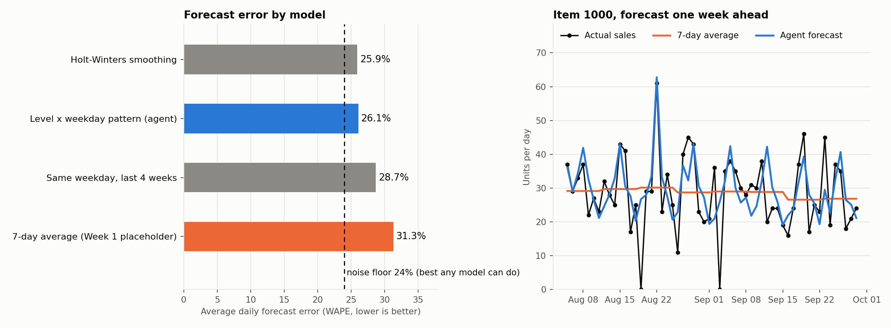

# Demand Forecasting Agent: Week 2 Evaluation

Rolling backtest over 40 weekly forecasts (2025-12-24 to 2026-09-29), 54 items, 7-day horizon. Each forecast uses only data from before its start date.

## Headline
- Average daily error (WAPE) fell from **31.3%** (Week 1 placeholder: 7-day average) to **26.1%** (agent), a **17% reduction**.
- The synthetic data has random day-to-day noise that no model can predict. A model that knew the true patterns would still score about **24.0%**, so the agent closes **71%** of the achievable gap. More complex models (ML) would gain little here.
- Over-forecasting bias is small: +2.0% (positive = over-forecast).
- Weekly total error: 11.8% (vs 14.6%), the number that matters for a weekly order.

## Model comparison (all backtest weeks)
| Model | Daily WAPE | Weekly-total WAPE | MAE (units) | RMSE (units) | Bias |
|---|---|---|---|---|---|
| Holt-Winters smoothing | 25.9% | 11.4% | 5.19 | 7.83 | +2.3% |
| Level x weekday pattern (agent) | 26.1% | 11.8% | 5.22 | 7.88 | +2.0% |
| Same weekday, last 4 weeks | 28.7% | 12.2% | 5.75 | 8.61 | -0.7% |
| 7-day average (Week 1 placeholder) | 31.3% | 14.6% | 6.27 | 9.10 | +0.7% |

**Model choice.** `level x weekday pattern` and Holt-Winters finished within noise of each other (first half 26.9% vs 26.7%; second half 25.3% vs 25.2%). The agent uses the simpler, easier-to-explain one. Tuning used only the first half of the weeks.

## Where it helps and where it doesn't

**By category**
| | Agent | 7-day average | Error reduction |
|---|---|---|---|
| BAKERY | 25.4% | 30.6% | 17.1% |
| BEVERAGES | 27.0% | 32.0% | 15.7% |
| DAIRY | 25.5% | 31.3% | 18.5% |
| EGGS | 28.6% | 34.1% | 16.3% |
| GROCERY_DRY | 26.1% | 31.4% | 16.8% |
| MEATS | 26.1% | 31.9% | 18.2% |
| POULTRY | 26.2% | 31.1% | 16.0% |
| PRODUCE | 25.7% | 30.6% | 16.1% |
| SEAFOOD | 27.1% | 32.6% | 16.9% |

**By period**
| | Agent | 7-day average | Error reduction |
|---|---|---|---|
| Holiday bump (Nov 20-Jan 2) | 25.3% | 29.7% | 15.0% |
| Normal weeks | 26.1% | 31.4% | 16.8% |

**By day type**
| | Agent | 7-day average | Error reduction |
|---|---|---|---|
| Fri-Sun | 26.3% | 30.7% | 14.4% |
| Mon-Thu | 25.9% | 32.0% | 19.1% |

**By promotion**
| | Agent | 7-day average | Error reduction |
|---|---|---|---|
| Non-promo days | 25.9% | 30.9% | 16.0% |
| Promo days | 27.5% | 35.3% | 22.1% |

## Uncertainty ranges
The agent returns an 80% range. Checked out of sample (range sized from earlier weeks only), actual sales landed inside it **83.0%** of the time per day and **83.5%** per week. Slightly above the 80% target, so ranges run a little wide (cautious) rather than too narrow.

## Limitations (state these plainly)
- **Synthetic data.** Patterns are simulated, so absolute error numbers will differ on real restaurant data. The method and the comparison against the baseline carry over; the exact percentages do not.
- **Promotions are assumed known in advance** (restaurants plan them). With no planned promo the agent assumes none; an unplanned promo day is a forecast miss.
- **One year of history.** The model cannot learn yearly seasonality, so it cannot anticipate the holiday bump; it can only adapt after demand has already shifted. The backtest starts Dec 24, so it sees only the last ~10 days of the bump and the drop after it. The bump's start (Nov 20) falls in the warm-up period and was not evaluated, so the 'By period' table above says little about that risk.
- **Weekday pattern is learned per item** from 12 weeks, so a brand-new item (under 28 days of history) gets a flat average with no range instead.

## Reproduce
`python scripts/evaluate_demand_agent.py` regenerates this report, the chart, and `demand_backtest_metrics.csv`.
