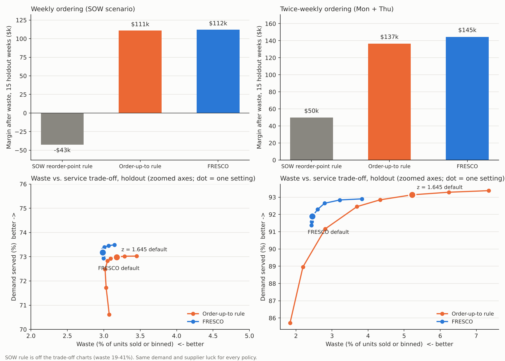

# FRESCO System Evaluation (Weeks 8-9)

Replay of **32 weeks** (2026-02-16 to 2026-09-27), 54 items. Every Monday (and Thursday in the twice-weekly runs) each policy places orders using only what it could know that morning. Orders arrive after the supplier lead time, some units arrive short, customers buy from the oldest stock first, and expired stock is binned. The first 2 weeks are warm-up; the next 15 are **dev**, the last 15 are **holdout**. All numbers below are **holdout** unless stated.

## Headline
- **Acceptance criterion met.** Against the SOW reorder-point rule, FRESCO cuts waste from 40.5% to 3.0% of units and raises demand served from 63.6% to 73.2% under the weekly cadence. Margin after waste goes from -$42,570 to $112,102 over 15 weeks. Every one of the 15 holdout weeks is better.
- **Against a stronger rule, weekly ordering: a small gain.** The stronger baseline (order-up-to, shelf-life aware, given full-year demand statistics) is very close: FRESCO earns 1.1% more margin and 10% less waste cost. On holdout the paired bootstrap interval excludes zero ($78/wk (95% CI $12 to $145)), but on dev it does not ($38/wk (95% CI -$21 to $92)). Treat this as a **small edge, not a clear win**.
- **Twice-weekly ordering: a clear win.** FRESCO earns 5.9% more margin than the stronger rule ($534/wk (95% CI $435 to $618); interval above zero on dev and holdout) and cuts waste cost by 53%. It serves slightly *less* demand (91.9% vs 93.1%), a deliberate trade the cost logic makes.
- **The biggest finding is about cadence, not about agents.** Short-shelf-life items (bakery, meat, poultry, seafood, produce, 1-6 days) cannot be served from one weekly delivery by anyone. Moving from one order a week to two raises FRESCO's demand served from 73% to 92% and margin from $112,102 to $144,518.

## Weekly ordering (the SOW scenario)
| Policy | Demand served | Stockout rate | Waste rate | Waste cost | Lost margin | Margin after waste |
|---|---|---|---|---|---|---|
| SOW reorder-point rule | 63.6% | 36.4% | 40.5% | $148,252 | $64,454 | -$42,570 |
| Order-up-to rule | 73.0% | 27.0% | 3.2% | $7,989 | $51,221 | $110,925 |
| FRESCO | 73.2% | 26.8% | 3.0% | $7,185 | $50,849 | $112,102 |

## Twice-weekly ordering (extension)
| Policy | Demand served | Stockout rate | Waste rate | Waste cost | Lost margin | Margin after waste |
|---|---|---|---|---|---|---|
| SOW reorder-point rule | 70.3% | 29.7% | 19.1% | $66,281 | $54,084 | $49,771 |
| Order-up-to rule | 93.1% | 6.9% | 5.2% | $17,286 | $16,341 | $136,508 |
| FRESCO | 91.9% | 8.1% | 2.5% | $8,059 | $17,558 | $144,518 |

## Is the gain just a different trade-off?
The lower charts sweep each method's main dial: FRESCO's stockout penalty (0 to 4x price) and the baseline's safety factor z (-0.5 to 2.5). Under twice-weekly ordering FRESCO's curve sits above and to the left of the baseline's: at matched waste it serves more, at matched service it wastes less, so the gain is not an artefact of picking a different point on the same curve. Under weekly ordering the two curves almost coincide, which matches the near-tie above.

## Where the gain comes from (twice-weekly, holdout)
| Category | Served (base) | Served (FRESCO) | Waste (base) | Waste (FRESCO) | Margin (base) | Margin (FRESCO) |
|---|---|---|---|---|---|---|
| BAKERY | 79.2% | 77.8% | 12.3% | 6.6% | $10,410 | $11,800 |
| BEVERAGES | 99.7% | 100.0% | 0.0% | 0.0% | $26,428 | $26,459 |
| DAIRY | 99.9% | 99.2% | 0.0% | 0.0% | $19,076 | $18,937 |
| EGGS | 99.6% | 100.0% | 0.0% | 0.0% | $3,196 | $3,210 |
| GROCERY_DRY | 99.8% | 99.9% | 0.0% | 0.0% | $21,572 | $21,613 |
| MEATS | 93.9% | 92.2% | 10.0% | 3.2% | $23,546 | $27,281 |
| POULTRY | 83.1% | 81.6% | 12.1% | 6.4% | $9,231 | $10,228 |
| PRODUCE | 95.2% | 91.9% | 7.0% | 3.1% | $16,878 | $18,318 |
| SEAFOOD | 54.5% | 56.4% | 13.1% | 12.1% | $6,171 | $6,671 |

Long-life categories (beverages, dry grocery, eggs) are a wash: both methods keep them in stock. The gain is in perishables, where FRESCO's day-by-day netting of expiring stock and its cost-based service level matter.

## Do the agents (not just the numbers) behave?
- Critic, weekly runs: 1728 item plans, 0 objections, 0 escalations; 866 plans carried a warning, mostly "short late in the week because of shelf life" or "waste risk accepted".
- Critic, twice-weekly runs: 3456 item plans, **169 objections that the replan loop resolved in one retry**, 0 escalations to a human.
- The replan loop is also exercised by unit tests that inject a bad first proposal and a stubborn optimizer, and by the demo (new supplier terms, a stock-count correction, a budget cut).
- Unit conservation (delivered = sold + wasted + left on the shelf) held in every run.

## Robustness
Five different supplier-luck seeds (holdout): FRESCO margin ranges $112,102-$112,207 (weekly) and $144,340-$144,634 (twice-weekly); the stronger baseline $110,925-$111,164 and $136,370-$136,755. The ordering of the policies never changes.

## Limitations (state these plainly)
- **Synthetic data.** Demand is simulated with weekday/promo patterns and random noise; absolute dollars won't carry over to a real restaurant, the method and relative comparisons should.
- **One year, one location.** Yearly seasonality can't be learned. The replayed weeks (Feb-Sep) exclude the Nov-Jan holiday bump, so behaviour during that spike is untested here.
- **Stronger baseline is generous.** It uses full-year demand statistics, which include the future. FRESCO does not get that.
- **FRESCO knows planned promotions** in advance (a restaurant plans them); the baselines ignore them.
- **Supplier model is simple.** Each ordered unit arrives with the catalog probability; lead times and prices are fixed; one supplier per item; no holding cost or order fees. An order below the minimum is shipped as the minimum.
- **Twice-weekly ordering extends the SOW**, which specifies a weekly decision. It assumes suppliers will deliver twice a week; the weekly result is the one that matches the SOW exactly.
- **Absolute service is low under weekly ordering** (73%) because of the shelf-life limit above. That is a property of the scenario, not a tuning failure.
- **Settings were not tuned on holdout.** FRESCO's stockout penalty (0.25x price) was fixed from the cost logic. The sweep shows results are flat around it under weekly ordering and best near 0.25-0.5 under twice-weekly.
- Critic thresholds (15% / 20% / 10%) are judgment calls; they are named constants at the top of `agents/critic_agent.py`.

## Reproduce
`python scripts/evaluate_system.py` (about 70 seconds) regenerates `system_evaluation_data.json`, the chart and this report.
